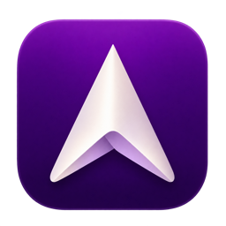
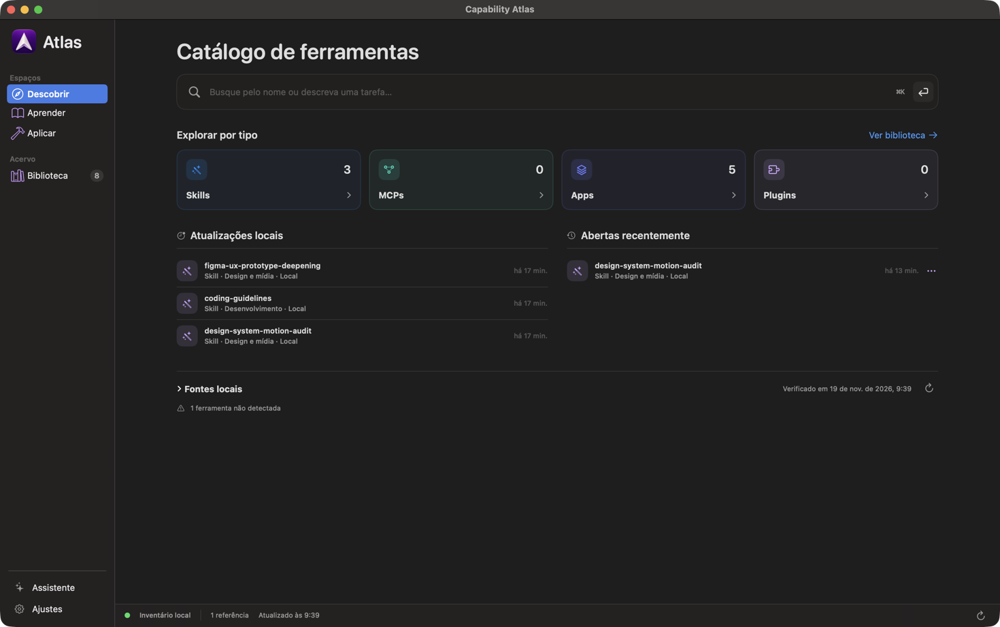
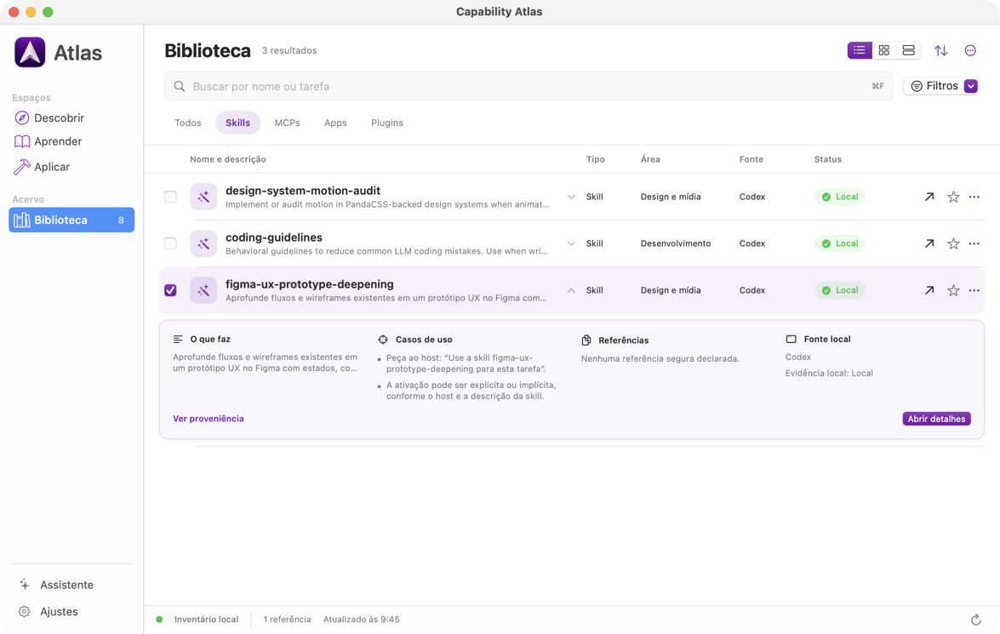
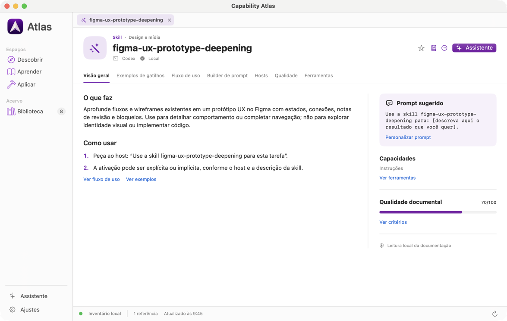

  

<h1 align="center">Capability Atlas</h1>

  Um catálogo das skills, servidores MCP, apps e plugins que você tem no Mac. 
  Busque pela tarefa que quer realizar e descubra como usar cada ferramenta.

  

  macOS 14 ou posterior · Apple Silicon e Intel · <a href="https://github.com/pedronazarito98/CapabilityAtlas-Releases/releases/tag/v0.1.0">Notas da versão 0.1.0</a>

## Encontre uma ferramenta

Pressione **⌘K** e descreva o que você quer fazer. Se preferir explorar o que está instalado, escolha **Skills**, **MCPs**, **Apps** ou **Plugins**.

## Explore a biblioteca

Filtre por **Skills** e selecione uma para ver o que faz, em qual app está disponível e de onde vieram as informações. A prévia se abre na própria lista.

## Veja como usar uma skill

Em **Abrir detalhes**, a ficha reúne instruções de uso, exemplos e um prompt que você pode personalizar. Quando a skill inclui referências, elas abrem em abas no Atlas.

## Instalação

1. [Baixe o ZIP universal para macOS](https://github.com/pedronazarito98/CapabilityAtlas-Releases/releases/download/v0.1.0/CapabilityAtlas-0.1.0-universal.zip) e descompacte-o.
2. Arraste **CapabilityAtlas.app** para **Aplicativos** e abra o app.

O app é assinado com Developer ID e notarizado pela Apple. O SHA-256 do ZIP está nas [notas da versão](https://github.com/pedronazarito98/CapabilityAtlas-Releases/releases/tag/v0.1.0). [Ver todas as versões](https://github.com/pedronazarito98/CapabilityAtlas-Releases/releases)
